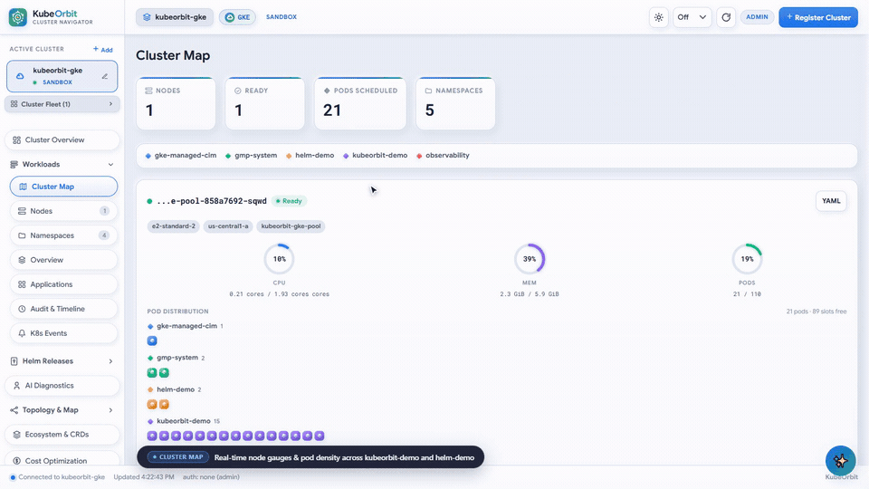

# ☸️ KubeOrbit

[](./LICENSE)
[](#-security-architecture)
[](#-security-architecture)
[](#-interactive-ai-stack-ag-ui--google-adk--mcp)
[](#-interactive-ai-stack-ag-ui--google-adk--mcp)
[](https://medium.com/@r.naveen.reddy.099/why-security-teams-keep-banning-lens-and-k9s-in-prod-so-i-built-a-read-only-k8s-portal-b257082c4566)
[](https://glama.ai/mcp/servers/naveen-engg/kubeorbit-portal)

> **Strictly Read-Only Multi-Cloud Kubernetes Diagnostics Portal, 12-Step `kubectl apply` Machine, Server-Side Secret-Masked Helm Diff & AG-UI ↔ Google ADK ↔ MCP Navigator**  
> Unified web control plane across **GCP GKE**, **AWS EKS**, **Azure AKS**, and **Local Kubernetes** (Minikube / Docker Desktop / Kind) — built so developers and on-call SREs can diagnose staging & production safely with **zero write permissions**, **zero Secret exposure**, and **zero static cloud credentials**.

---

## 🎬 Live Interactive Walkthrough

[](https://github.com/naveen-engg/kubeorbit-portal/blob/main/docs/images/kubeorbit_live_demo.mp4)

**[▶ Watch / Download Full 2m 41s Live HD Walkthrough (MP4)](https://github.com/naveen-engg/kubeorbit-portal/blob/main/docs/images/kubeorbit_live_demo.mp4)** · **[📖 Read the Full Architecture Write-Up on Medium](https://medium.com/@r.naveen.reddy.099/why-security-teams-keep-banning-lens-and-k9s-in-prod-so-i-built-a-read-only-k8s-portal-b257082c4566)**

*Live GKE recording: Cluster Map · Nodes · Namespaces (`kubeorbit-demo` & `helm-demo`) · Metadata-Only Secrets · Resource, Network & Storage Maps · Secret-Masked Helm Diff · Animated 12-Step Machine · Sliding Ask AI with Bidirectional Live UI Sync · Cost Optimization*

---

## 🧭 Why KubeOrbit?

Most Kubernetes tools (Lens, K9s, Headlamp, Rancher) assume desktop `~/.kube/config` sprawl and write/exec permissions — which is exactly why SecOps teams ban developers from connecting them to production clusters.

**KubeOrbit turns strict read-only safety into its core design:**
- **Strictly Read-Only by Default (`KUBEORBIT_READ_ONLY=true`)**: Zero `kubectl exec`, zero YAML edits, zero pod deletions, and cluster write endpoints return `403 Forbidden` out of the box.
- **Zero Kubernetes Secret Value Exposure**: Secret value reveal is permanently removed, `GET /manifest?kind=Secret` (including `secrets.v1` / `v1/Secret`) returns `403 Forbidden`, resource lists return **metadata only** (name, type, key names), and Helm values/manifest diffs **mask all secret values server-side** with SHA-256 change fingerprints (`<masked:fp=...>`) so you can still spot secret rotations without leaking plaintext.
- **Zero-Pollution Multi-Cloud Access**: Isolated per-cluster kubeconfigs under `~/.kubeorbit/kubeconfigs/<cluster-id>.yaml`, keyless OIDC Workload Identity Federation across GCP/AWS/Azure, and in-process Python Kubernetes SDK connection pooling.
- **The 12-Step `kubectl apply` Machine**: Interactive radial telemetry diagram and Root-Cause Analysis (RCA) engine tracing every workload from `kubectl apply` (Step 1) through `kube-apiserver`, `etcd`, controllers, `kube-scheduler` (Step 9), `kubelet` (Steps 10a–10d), readiness probes (Step 11), and `EndpointSlice` traffic routing (Step 12), with live **Helm**, **Argo CD**, and **Prometheus** delivery detection.
- **Complete Helm Governance Suite**: Cluster-wide **Helm Releases** inventory with clickable live resource health squares, full **Version History** timeline, and a side-by-side **Diff Viewer** across User Values, Computed Values, and Rendered Manifests.
- **AG-UI v1.0 ↔ Google ADK ↔ 27 Read-Only MCP Tools**: Docked, resizable sliding **Ask AI** split-pane drawer powered by Vertex AI Gemini (`gemini-3.5-flash`), streaming AG-UI SSE events, interactive drill-down MCP result cards, and live Portal UI sync — plus a standalone FastMCP server (`stdio` / Streamable HTTP) for external AI clients.

---

## ⚖️ How KubeOrbit Compares (2026 Landscape)

| Capability | **KubeOrbit** | **Headlamp** *(CNCF)* | **Lens Desktop** | **K9s** | **Rancher** | **Komodor** | **HolmesGPT / K8sGPT** *(CNCF)* |
| :--- | :---: | :---: | :---: | :---: | :---: | :---: | :---: |
| **Strictly Read-Only by Default** | **Yes** | No *(RBAC-based write)* | No *(IDE write/exec)* | No *(TUI write/exec)* | No *(full lifecycle)* | Guarded writes | Mostly read-only |
| **Hard Block on K8s Secret Values & YAML** | **Yes (`403` + masked Helm diffs)** | Follows K8s RBAC | Decodes if RBAC allows | Decodes (`x`) if RBAC allows | Follows RBAC | Governance RBAC | `--anonymize` flag (K8sGPT) |
| **Zero-Agent Single Container (Cloud Run / Docker)** | **Yes** | Desktop or in-cluster | Heavy Electron app | Local Go binary | Heavy HA control plane | SaaS + in-cluster agent | CLI / in-cluster operator |
| **Native Multi-Cloud Keyless WIF (GKE + EKS + AKS)** | **Yes** | Local/OIDC kubeconfig | Local kubeconfig | Local kubeconfig | Cluster agents | In-cluster agents | Local / operator |
| **12-Step Visual `kubectl apply` RCA** | **Built-in** | — | — | — | — | Change timeline | Text/Slack RCA |
| **Network, Storage & Resource Topology Maps** | **Built-in** | Plugins | Basic | — | Basic | Service map | — |
| **Helm History & Secret-Masked Revision Diff** | **Built-in** | Basic / plugins | Manage charts | Basic | App catalog | Change tracking | — |
| **Live AG-UI Sliding Split-Pane + 27 Read-Only MCP Tools** | **Built-in** | Plugins | Paid Prism AI | Plugins | — | Commercial AI SRE | Strong CLI/Slack/MCP |
| **License & Pricing** | **Apache 2.0 (Free)** | Apache 2.0 (Free) | Freemium / Paid Pro | Apache 2.0 (Free) | OSS / Paid Prime | Enterprise Contract | Apache 2.0 (Free) |

---

## 🏛️ System Architecture

[](https://raw.githubusercontent.com/naveen-engg/kubeorbit-portal/main/docs/images/kubeorbit_architecture.png)

*\*`ui_open_manifest` and `GET /manifest` enforce a hard block (`403` / `ok=False`) on `Secret` objects. Dashed LLM nodes (`Anthropic Claude` and `OpenAI GPT`) are pluggable placeholder adapters wired via Google ADK's LiteLLM bridge.*

---

## ⚓ Helm Releases, Version History & Secret-Masked Diff

Built in [`kube_client/helm.py`](./kube_client/helm.py) and [`static/helm.js`](./static/helm.js):
- **Helm Releases View**: Lists releases across namespaces with search/namespace filters, current revision, chart/app version, live status pill, and clickable **resource health squares** (clicking a Pod opens Pod Inspector; clicking a Secret safely opens the masked Release Details modal).
- **Helm Version History View**: Full revision timeline per release (`deployed`, `superseded`, `failed`), descriptions, timestamps, and 1-click **`vs previous`** / **`vs current`** diff shortcuts.
- **Helm Diff Viewer**: Side-by-side / unified diff across **User Values**, **Computed Values**, and **Rendered Manifest YAML** with **server-side secret masking** — every Kubernetes `Secret` `data`/`stringData` entry and credential-like key (`password`, `token`, `api_key`, `private_key`, etc.) is replaced with a deterministic fingerprint (`<masked:fp=a1b2c3d4>`) so engineers can verify whether a secret changed between revisions without ever seeing the raw secret.

---

## 🤖 Interactive AI Stack (AG-UI ↔ Google ADK ↔ MCP)

KubeOrbit implements the **AG-UI (Agent-to-UI) Protocol v1.0** natively over Server-Sent Events (`POST /api/clusters/{cluster_id}/ai/ag-ui`) backed by **Google ADK (`google-adk`)** with pluggable LLM providers — **Vertex AI Gemini** (`gemini-3.5-flash`, active default with zero static API keys via ADC or attached Cloud Run Service Account), plus **Anthropic Claude** and **OpenAI** placeholder adapters wired via Google ADK's LiteLLM bridge (`KUBEORBIT_AI_PROVIDER=claude|openai`):

- **Docked Sliding Split-Pane Drawer**: Smoothly docks alongside the active view (`#ai-chat-panel`) with a draggable column resizer (`320px–760px`, persisted in `localStorage`) and automatic SVG reflow so topologies and 12-Step diagrams stay visible side-by-side.
- **Context-Aware Quick Prompts**: Dynamically adapts to the active portal view and selected namespace.
- **Interactive Drill-Down MCP Cards ([`static/agui_views.js`](./static/agui_views.js))**: Rich interactive cards for namespaces, namespace resources (Secrets clearly marked **`Metadata only`**), Helm releases/history/diffs, events, nodes, workloads, 12-Step RCA, pod inspector, logs, manifests, topologies, ecosystem CRDs, cost, and audit logs — plus a collapsed **`Raw JSON & Args`** drawer on every card.
- **Standalone Read-Only MCP Server ([`mcp_server/README.md`](./mcp_server/README.md))**: All **27 read-only MCP tools** (`readOnlyHint=True`, `destructiveHint=False`, strictly HTTP `GET`), including `get_helm_releases`, `get_helm_release_details`, `get_helm_release_history`, and `diff_helm_revisions`:

```bash
# Stdio transport (Claude Desktop, Cursor, Gemini CLI, local ADK clients)
python -m mcp_server.server

# Streamable HTTP transport (standalone MCP service)
KUBEORBIT_MCP_TRANSPORT=streamable-http python -m mcp_server.server
```

[](https://glama.ai/mcp/servers/naveen-engg/kubeorbit-portal)

---

## 🔬 The 12-Step `kubectl apply` Machine & Autonomous RCA

Built in [`kube_client/rca.py`](./kube_client/rca.py) and documented in [`docs/12_STEP_KUBECTL_APPLY_MACHINE.md`](./docs/12_STEP_KUBECTL_APPLY_MACHINE.md) *(visual mental model inspired by Deepak Agrawal's ["The kubectl apply Machine" post](https://www.linkedin.com/feed/update/urn:li:activity:7528683967684702208/) / [`infra360.io`](https://infra360.io), brought to life with real-time Kubernetes API telemetry)*:
- **End-to-End Pipeline Attribution**: Maps live pods, events, deployments, ReplicaSets, services, NetworkPolicies, and logs onto Steps `1–12`:
  - **Steps 1–6 (Control Plane & Storage)**: `kubectl apply` (`1`) → `authn` (`2`) → `rbac-authz` (`3`) → `mutating-admission` (`4`) → `schema/validating-admission` (`5`) → `etcd` (`6`).
  - **Steps 7–8 (Controllers)**: `deployment-controller` (`7`) → `replicaset-controller` + `pod-security` / `ResourceQuota` (`8`).
  - **Step 9 (`kube-scheduler`)**: Node capacity, taints/tolerations, affinity, unbound PVC (`Pending`).
  - **Step 10 (`kubelet`)**: `10a` CSI/Secret mount, `10b` CNI sandbox, `10c` Image pull (`ImagePullBackOff`), `10d` `containerd` runtime (`CrashLoopBackOff`, `OOMKilled`, `CreateContainerConfigError`).
  - **Step 11 (`readinessProbe`)**: Running container `0/1 Ready`.
  - **Step 12 (`endpointslice-controller` / `kube-proxy`)**: 0 ready Service endpoints / missing `NetworkPolicy`.
- **Interactive Telemetry**: Namespace filter, clickable step badges (`1–12`), symptom folding into ranked Root Causes with exact `kubectl` verification/remediation commands, **`▶ Replay 12-Step Flow`** animation, and live **Helm**, **Argo CD**, and **Prometheus** pipeline detection.

---

## ⚡ Performance Engineering

Engineered for snappy multi-cluster navigation on Cloud Run and local workstations:
- **Client-Side SWR Cache (`static/app.js`, `static/helm.js`)**: Instant `0ms` paint on recently visited tabs (`<10s`), instant stale paint + silent background refresh (`10–30s`), 30s Helm inventory/history reuse, 60s sidebar `/nodes` throttle, and explicit top-bar **Refresh** (`POST /api/clusters/{id}/refresh`) that busts both client and server data caches on demand.
- **Backend Concurrency & Caching (`kube_client/`)**: Per-cluster SDK init locks, Gateway API group-qualified SDK reads, 300s cluster-wide negative caching for absent optional CRDs (`crd_missing`), single-call CRD discovery (`ApiextensionsV1Api`), skipping `kubectl top pods` on views that don't display pod metrics, cached enriched Helm release payloads, parallelized `/info`/topology gathers, and non-blocking background GCP Secret Manager refresh (`config.py`).
- **Transport Optimization (`app.py`, `static/index.html`)**: `SSEAwareGZipMiddleware` (compresses JSON/JS/CSS without buffering `/ai/ag-ui` SSE streams), `<link rel="modulepreload">` eliminating duplicate ES-module downloads, versioned `?v=` static cache headers, and an inline SVG favicon.

---

## 📁 Repository Structure

```text
.
├── app.py                        # FastAPI server, REST routes, AG-UI SSE, SSEAwareGZip, static caching
├── ai_agent.py                   # Google ADK LlmAgent, Vertex AI setup, AG-UI v1.0 & 6 UI tools
├── auth.py                       # IAP / Azure AD / API Key auth, 3-Tier RBAC, GCP Custom IAM lookup
├── config.py                     # Multi-cloud ConfigStore, RuntimeEnv (KUBEORBIT_READ_ONLY), async Secret Manager sync
├── kube_client/                  # Modular Kubernetes & Helm engine (official SDK + async CLI helpers)
│   ├── _cache.py                 # Singleflight async TTLCache
│   ├── _cli.py                   # Flag-injection & timeout guarded subprocess runner
│   ├── _fetch.py / _sdk.py       # SDK list adapters, CRD negative cache & pooled API clients
│   ├── helm.py                   # Helm inventory, revision history, server-side secret masking & structured diff
│   ├── rca.py                    # 12-Step kubectl apply RCA engine, folding & delivery detection
│   ├── logs.py                   # Pod logs & Secret-blocked resource YAML fetcher (is_secret_kind)
│   └── workloads.py / resources.py / topology.py / ecosystem.py / events.py / audit.py / normalize.py
├── mcp_server/                   # Standalone & in-process Read-Only FastMCP server (27 HTTP-GET tools)
├── providers/                    # Pluggable cluster auth & cloud metadata adapters (gke, eks, aks, local, pricing)
├── static/                       # Zero-build ES-module frontend (index.html, app.js, helm.js, agui.js, agui_views.js, ...)
├── tests/                        # 115+ unit, integration, concurrency, Helm, AG-UI, and security tests
├── config/clusters.example.yaml  # Sample multi-team / multi-cloud cluster registry
├── docs/                         # 12-Step kubectl apply Machine documentation & diagrams
├── sample-app.yaml               # Demo K8s workloads + intentional Step 9–12 stall scenarios
├── LICENSE                       # Apache License 2.0
└── Dockerfile / docker-compose.yml / start-docker.ps1 / start-docker.sh
```

---

## ☁️ Cloud, Local & Keyless Federation Support

| Hosting Environment | Target Cluster | Authentication Protocol | Static Secret Required? |
| :--- | :--- | :--- | :---: |
| **Local Workstation / Docker** | **GKE / EKS / AKS / Local** | Host `gcloud`, `aws`, `az`, `~/.kube/config` session mounts | **Zero Keys** |
| **GCP Cloud Run** | **GCP GKE** | Attached `kubeorbit-runner` SA + `gke-gcloud-auth-plugin` (or SA impersonation) | **Zero Keys** |
| **GCP Cloud Run** | **AWS EKS** | GCP OIDC ID Token → `aws sts assume-role-with-web-identity` (`providers/eks.py`) | **Zero Keys** |
| **GCP Cloud Run** | **Azure AKS** | GCP OIDC ID Token → `az login --federated-token` + `kubelogin` (`providers/aks.py`) | **Zero Keys** |
| **AWS ECS Fargate** | **EKS / GKE / AKS** | ECS Task Role + STS / GCP WIF Pool / Entra Federated Identity | **Zero Keys** |
| **Azure Container Apps** | **AKS / GKE / EKS** | User-Assigned Managed Identity + `kubelogin` / GCP WIF / AWS OIDC | **Zero Keys** |

---

## 🚀 60-Second Quick Start (Local Demo)

### Option A: Native Python
1. **Prerequisites**: Python 3.10+, `kubectl`, optional `helm` / `gcloud` / `aws` / `az`.
2. **Install & Configure**:
   ```bash
   python -m venv .venv
   # Linux / macOS:
   source .venv/bin/activate
   # Windows PowerShell:
   .venv\Scripts\Activate.ps1

   pip install -r requirements.txt
   cp .env.example .env
   cp config/clusters.example.yaml config/clusters.yaml
   ```
3. **Run the Portal**:
   ```bash
   python -m uvicorn app:app --reload --port 8080
   ```
   Open **http://127.0.0.1:8080** in your browser.
4. *(Optional)* Deploy [`sample-app.yaml`](./sample-app.yaml) into a sandbox/Kind/Minikube cluster to watch healthy workloads alongside intentional Step 9 (`Pending`), Step 10 (`ImagePullBackOff` / `CrashLoopBackOff`), Step 11 (`0/1 Ready`), and Step 12 (orphaned Service) stalls light up the **12-Step Machine**.

### Option B: Zero-Keys Docker Compose
```powershell
# Windows PowerShell
.\start-docker.ps1
```
```bash
# Linux / macOS
chmod +x start-docker.sh && ./start-docker.sh
# Or directly:
docker compose up -d --build
```
Verify status: `curl http://localhost:8080/api/status`.

---

## 🔒 Security Architecture

- **Strictly Read-Only Default (`KUBEORBIT_READ_ONLY=true`)**: Cluster mutation routes (including workload rollback and AI HITL rollback proposals) return `403` / disabled unless an operator explicitly opts in with `KUBEORBIT_READ_ONLY=false`.
- **Zero Kubernetes Secret Value Exposure**:
  - No secret decode / reveal route exists.
  - `GET /api/clusters/{id}/manifest` and `kube_client.get_resource_yaml()` reject `Secret`, `secrets`, `secrets.v1`, and `v1/Secret` with `403 Forbidden` / `PermissionError`.
  - Namespace resource tables, Resource Map, and AG-UI cards expose Secret **metadata only** (name, type, key names).
  - Helm release details and diffs mask all secret data and credential-like values **server-side** before returning JSON.
- **Portal Auth & Zero-Trust 3-Tier RBAC (`auth.py`)**: Supports `none` (local dev), `api_key` (`X-API-Key` constant-time check), `iap` (GCP Identity-Aware Proxy + cryptographic `X-Goog-IAP-JWT-Assertion` verification), and `azure_ad` (Easy Auth), with dynamic GCP Project Custom IAM Role resolution (`kubeorbitAdmin`, `kubeorbitOperator`, `kubeorbitViewer`, including versioned suffixes like `_v2`) and `KUBEORBIT_STRICT_RBAC=true` zero-trust lockout.
- **Hardening**: Strict regex validation on every path/query segment, subprocess flag-injection guards, local kubeconfig path/symlink traversal checks, `KUBEORBIT_DISABLE_LOCAL_PROVIDER=true` auto-enabled on Cloud Run/IAP, security response headers (`X-Frame-Options: SAMEORIGIN`, `X-Content-Type-Options: nosniff`), and non-root container user (`kubeorbit`, UID `10001`).

---

## ⚙️ Configuration Reference

### Environment Variables

| Category | Variable | Default | Purpose |
| :--- | :--- | :--- | :--- |
| **Security** | `KUBEORBIT_READ_ONLY` | `true` | Enforce strictly read-only cluster mode (blocks workload rollback writes) |
| **Core** | `KUBEORBIT_CONFIG_PATH` | `config/clusters.yaml` | Path to cluster YAML registry |
| **Core** | `KUBEORBIT_KUBECONFIG_HOME` | `~/.kubeorbit/kubeconfigs` | Isolated per-cluster kubeconfig directory |
| **Core** | `KUBEORBIT_DISABLE_LOCAL_PROVIDER` | Auto (`true` on Cloud Run / `iap`) | Disable `local` provider & server kubeconfig parsing |
| **Core** | `KUBEORBIT_CORS_ORIGINS` | `http://localhost:8000,http://localhost:8080` | Allowed CORS origin(s) |
| **Config Store** | `USE_GCP_SECRET_MANAGER` | `false` | Sync `clusters.yaml` from GCP Secret Manager (non-blocking background refresh) |
| **Config Store** | `GCP_PROJECT_ID` / `GCP_SECRET_NAME` | unset / `kubeorbit-clusters-yaml` | Secret Manager project and secret name for `clusters.yaml` |
| **Config Store** | `KUBEORBIT_SECRET_SYNC_TTL_SEC` | `120` | Background Secret Manager config refresh interval (seconds) |
| **Auth / RBAC** | `KUBEORBIT_AUTH_MODE` | `none` | Portal auth: `none` \| `api_key` \| `iap` \| `azure_ad` |
| **Auth / RBAC** | `KUBEORBIT_API_KEY` | unset | Shared secret for `api_key` mode (`X-API-Key`) |
| **Auth / RBAC** | `KUBEORBIT_IAP_AUDIENCE` | unset | Expected IAP JWT audience for cryptographic assertion verification |
| **Auth / RBAC** | `KUBEORBIT_GCP_IAM_RBAC` | `false` | Resolve roles dynamically from `kubeorbitAdmin/Operator/Viewer` IAM bindings |
| **Auth / RBAC** | `KUBEORBIT_STRICT_RBAC` | `false` | Deny (`403`) any authenticated user without an explicit role |
| **AI / ADK** | `KUBEORBIT_AI_PROVIDER` | `vertex_ai` | LLM provider: `vertex_ai` (active) \| `gemini` (active) \| `claude` *(placeholder)* \| `openai` *(placeholder)* |
| **AI / ADK** | `GOOGLE_GENAI_USE_VERTEXAI` | `TRUE` (when no `GOOGLE_API_KEY`) | Route Google ADK to Vertex AI (zero API keys) |
| **AI / ADK** | `GOOGLE_CLOUD_PROJECT` / `GOOGLE_CLOUD_LOCATION` | `adk-enterprise-observability` / `global` | Vertex AI project & location |
| **AI / ADK** | `KUBEORBIT_AI_MODEL` | `gemini-3.5-flash` | Model ID (`gemini-3.5-flash`, or placeholder `anthropic/claude-sonnet-4-20250514` / `openai/gpt-4o`) |
| **AI / ADK** | `ANTHROPIC_API_KEY` / `OPENAI_API_KEY` | unset *(placeholder)* | Placeholder API keys for Claude / OpenAI via Google ADK LiteLLM bridge (`pip install litellm`) |
| **MCP Server** | `KUBEORBIT_BASE_URL` / `KUBEORBIT_MCP_TRANSPORT` | `http://localhost:8080` / `stdio` | Standalone FastMCP target URL & transport (`stdio` \| `streamable-http`) |

---

## 🏢 Enterprise VPC Deployment (Commercial Pack)

For teams deploying **KubeOrbit** into regulated private AWS EKS, Azure AKS, or Google GKE environments, all modular Infrastructure-as-Code (`terraform/cloud-run/`, attach-only `terraform/attach-{eks,aks,gke}/`), our hardened non-root in-cluster Helm chart (`helm/kubeorbit-enterprise/`), and automated InfoSec audit scripts (`verify-infosec`) live in the **KubeOrbit Enterprise VPC Deployment Pack**:

- **Enterprise Pack & Architecture:** [**https://caliperops.dev/kubeorbit**](https://caliperops.dev/kubeorbit)
  - Hardened In-Cluster Helm Chart (`UID 10001`, `readOnlyRootFilesystem`, `NetworkPolicy`, non-secret `ClusterRole`)
  - Attach-only zero-key WIF Terraform for existing EKS, AKS, and GKE clusters + hardened GCP Cloud Run + IAP stack
  - Automated HTTP `403` & `kubectl auth can-i` InfoSec verification scripts and production upgrade runbooks

---

## 🧪 Automated Testing & Verification

```bash
# Run full Python test suite (115+ tests covering security, read-only guards, Helm masking, 12-Step RCA, AG-UI, MCP, concurrency)
.venv/bin/pytest -q          # Windows: .venv\Scripts\python.exe -m pytest -q

# Check ES-module JavaScript syntax
node --check static/api.js
node --check static/components.js
node --check static/app.js
node --check static/helm.js
node --check static/resourcemap.js
node --check static/agui.js
node --check static/agui_views.js
```

---

## 🤝 Enterprise Private VPC Rollout & Advisory

Want **KubeOrbit** deployed privately inside your GCP, AWS, or Azure VPC behind corporate SSO / OIDC / IAP with zero-key multi-cloud WIF and team onboarding?
- Request the **Enterprise VPC Pack ($499)** or **Private VPC Rollout & Support ($1,500)** at [**https://caliperops.dev/kubeorbit**](https://caliperops.dev/kubeorbit), or open a GitHub Discussion on [`naveen-engg/kubeorbit-portal`](https://github.com/naveen-engg/kubeorbit-portal).

---

## 🙏 Acknowledgments

- **12-Step `kubectl apply` Machine Visual Concept**: Inspired by **Deepak Agrawal** (["The kubectl apply Machine" LinkedIn post](https://www.linkedin.com/feed/update/urn:li:activity:7528683967684702208/) · [`infra360.io`](https://infra360.io)) — KubeOrbit reimagines that 12-step mental model as a live, interactive, multi-cloud diagnostic telemetry SVG and automated Root-Cause Analysis engine.

---

## 📄 License

Licensed under the **Apache License, Version 2.0** — see [`LICENSE`](./LICENSE) for full terms. Free for personal, team, and commercial self-hosted use.
