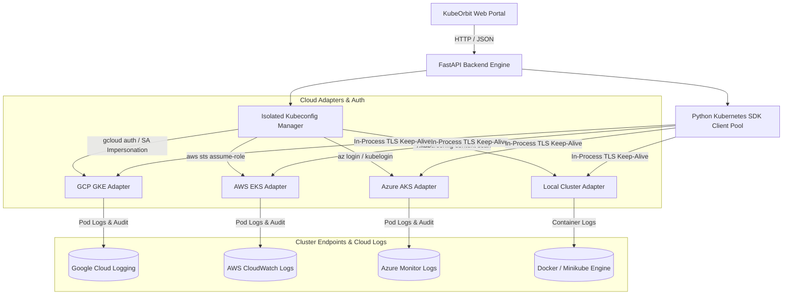

# ☸️ KubeOrbit
> **Multi-Cloud Cluster Navigator** — A unified portal connecting **GKE**, **EKS**, **AKS**, and **Local Kubernetes** (Minikube / Docker Desktop / Kind) clusters. One UI, one API, isolated credentials — the cloud behind a cluster is just a badge.

---

## 🧭 Overview & Portal Use Case

Modern engineering teams run Kubernetes workloads across multiple cloud providers and local development environments. Navigating, switching, and authenticating across fragmented cloud consoles and isolated kubeconfig files creates friction.

**KubeOrbit** solves this by providing a single, zero-pollution control plane to:
- **Connect & Switch Seamlessly**: Instantly onboard and switch between **GKE**, **EKS**, **AKS**, and **Local** clusters without context collisions.
- **Isolated Kubeconfigs**: Every connected cluster receives its own isolated kubeconfig file (`~/.kubeorbit/kubeconfigs/<cluster-id>.yaml`), eliminating `~/.kube/config` pollution.
- **In-Process Python SDK Client**: High-performance, low-latency resource inspection powered by the official Python Kubernetes SDK (`kubernetes`), connection pooling, and in-memory caching.
- **Cloud-Specific Log & Auth Integration**: Native cloud authentication adapters with zero hardcoded credentials and direct access to cluster logs and audit streams.

---

## 🏛️ Architecture & Multi-Cloud Connection Flow

```
                                  ┌──────────────────────────────────────────────────────────┐
                                  │                KubeOrbit Web Portal UI                   │
                                  │      (Pure HTML5 / Vanilla CSS / Material Design 3)      │
                                  └─────────────────────────────┬────────────────────────────┘
                                                                │ REST API / WebSocket
                                                                ▼
                                  ┌──────────────────────────────────────────────────────────┐
                                  │               FastAPI Backend Engine (app.py)            │
                                  │  - Auth Manager (auth.py)                                │
                                  │  - Config & Registry (config.py)                         │
                                  │  - Python Kube Client & Client Pool (kube_client.py)     │
                                  └──────────────┬────────────────────────────┬──────────────┘
                                                 │                            │
                     ┌───────────────────────────┴────────────┐               │
                     │ Isolated Kubeconfig Storage            │               │
                     │ (~/.kubeorbit/kubeconfigs/*.yaml)      │               │
                     └───────────────────────────┬────────────┘               │
                                                 │                            │
         ┌───────────────────────────────────────┼────────────────────────────┼───────────────────────────────────────┐
         │                                       │                            │                                       │
         ▼                                       ▼                            ▼                                       ▼
┌──────────────────┐                   ┌──────────────────┐         ┌──────────────────┐                   ┌──────────────────┐
│     GCP GKE      │                   │     AWS EKS      │         │    Azure AKS     │                   │  Local Clusters  │
├──────────────────┤                   ├──────────────────┤         ├──────────────────┤                   ├──────────────────┤
│ Auth:            │                   │ Auth:            │         │ Auth:            │                   │ Auth:            │
│  gcloud / IAM    │                   │  aws / STS Role  │         │  az / Entra ID   │                   │  Direct Certs    │
│  SA Impersonation│                   │  (AssumeRole)    │         │  (kubelogin)     │                   │  (Kube Context)  │
│                  │                   │                  │         │                  │                   │                  │
│ Logs:            │                   │ Logs:            │         │ Logs:            │                   │ Logs:            │
│  Cloud Logging   │                   │  CloudWatch Logs │         │  Azure Monitor   │                   │  Containerd /    │
│  (Stackdriver)   │                   │  (Log Streams)   │         │  (Log Analytics) │                   │  Docker Engine   │
└──────────────────┘                   └──────────────────┘         └──────────────────┘                   └──────────────────┘
```

### Visual Connection & Authentication Diagram (Mermaid)



---

## ☁️ Cloud & Local Connection Adapters

### 1. Google Kubernetes Engine (GKE)
- **Authentication**: Uses ambient `gcloud` credentials or Service Account impersonation (`roles/iam.serviceAccountTokenCreator`).
- **Data Plane**: Automatic token minting via `gke-gcloud-auth-plugin`.
- **Logs Architecture**:
  - **In-Cluster Container Logs**: Streamed directly via the Kubernetes API client.
  - **Control Plane & Cloud Audit Logs**: Exported to **Google Cloud Logging** (`projects/<id>/logs/cloudaudit.googleapis.com` & `k8s_container` logs).

### 2. AWS Elastic Kubernetes Service (EKS)
- **Authentication**: Leverages AWS CLI profiles or cross-account IAM role assumption via `sts:AssumeRole`.
- **Data Plane**: Generates short-lived presigned STS authentication tokens.
- **Logs Architecture**:
  - **In-Cluster Container Logs**: Streamed directly via the Kubernetes API client.
  - **Control Plane & Audit Logs**: Sent to **Amazon CloudWatch Log Groups** (`/aws/eks/<cluster-name>/cluster`).

### 3. Azure Kubernetes Service (AKS)
- **Authentication**: Interactive `az login` or dedicated Azure Service Principals (`AZURE_CLIENT_ID`, `AZURE_CLIENT_SECRET`, `AZURE_TENANT_ID`).
- **Data Plane**: Entra ID / Azure AD authentication handled transparently via `kubelogin`.
- **Logs Architecture**:
  - **In-Cluster Container Logs**: Streamed directly via the Kubernetes API client.
  - **Control Plane & Diagnostics**: Ingested into **Azure Log Analytics / Azure Monitor**.

### 4. Local Clusters (Minikube / Docker Desktop / Kind)
- **Authentication**: Directly inspects and extracts selected context configurations from local kubeconfig files (`~/.kube/config`) into isolated workspaces.
- **Data Plane**: Direct mutual TLS (mTLS) with client certificates or embedded tokens.
- **Logs Architecture**:
  - **In-Cluster Container Logs**: Streamed directly via the Kubernetes Core API.
  - **Host Container Runtime Logs**: Accessible via `minikube logs` or local Docker daemon stdout.

---

## 🚀 Quick Start (Local Setup)

You can run **KubeOrbit** either **natively with Python** on your machine or as a **Zero-Keys Docker container** with all cloud CLIs and host sessions pre-mounted.

---

### **Option A: Running Locally with Python (Native)**

#### 1. Prerequisites
- **Python 3.10+**
- **Kubernetes CLI (`kubectl`)**
- *(Optional)* Cloud CLIs for your clouds:
  - **GCP**: `gcloud` + `google-cloud-cli-gke-gcloud-auth-plugin`
  - **AWS**: `aws` (AWS CLI v2)
  - **Azure**: `az` (Azure CLI) + `kubelogin`

#### 2. Virtual Environment & Dependencies
```bash
# Clone the repository
cd k8s_lens

# Create virtual environment & activate
python -m venv .venv
source .venv/bin/activate       # On Windows: .venv\Scripts\activate

# Install dependencies (FastAPI, Uvicorn, Python Kubernetes SDK)
pip install -r requirements.txt
```

#### 3. Host Cloud Authentication (One-time)
```bash
# GCP GKE (OAuth2 + SA Impersonation)
gcloud auth login && gcloud auth application-default login

# AWS EKS (IAM SSO or Access Keys)
aws configure   # or: aws sso login

# Azure AKS (Entra ID Login)
az login

# Minikube / Local Kubernetes
minikube start --driver=docker
```

#### 4. Run KubeOrbit
```bash
python -m uvicorn app:app --reload --port 8080
```
Open **http://127.0.0.1:8080** in your browser.

---

### **Option B: Running with Docker Compose (Zero-Keys Container)**

The Docker setup runs KubeOrbit in an isolated Linux container bundled with `kubectl`, `helm`, `gcloud`, `aws`, and `az`. It mounts your active host cloud logins and local Kubernetes configurations directly into the container with **zero static JSON keys or passwords**.

#### 1. Prerequisites
- **Docker Desktop** (running on Windows, macOS, or Linux)
- Ensure placeholder CLI folders exist on your host (created automatically by the starter script):
  ```powershell
  # Windows PowerShell (if not already present):
  New-Item -ItemType Directory -Path "$HOME\.aws", "$HOME\.azure", "$HOME\.kubeorbit\kubeconfigs" -Force
  ```

#### 2. Start KubeOrbit Container
Use the automated startup script or standard `docker compose`:

* **On Windows (PowerShell)**:
  ```powershell
  .\start-docker.ps1
  ```

* **On Linux / macOS (Bash)**:
  ```bash
  chmod +x start-docker.sh
  ./start-docker.sh
  ```

* **Or using Docker Compose directly**:
  ```bash
  docker compose up -d --build
  ```

#### 3. Access KubeOrbit
Open **http://localhost:8080** in your browser.

#### 4. Managing the Docker Container
```bash
# View live logs
docker logs -f kubeorbit

# Restart container
docker compose restart

# Stop container
docker compose down

# Check container and CLI status
curl http://localhost:8080/api/status
```

---

### 📦 Docker Volume Mount Architecture

The container mounts the following host directories into the container to enable seamless multi-cloud access without copying static keys:

| Mount Mapping | Purpose |
| :--- | :--- |
| **`${APPDATA}/gcloud:/root/.config/gcloud`** | Shares host `gcloud auth login` session & Service Account impersonation. Tokens refresh automatically in background. |
| **`${USERPROFILE}/.aws:/root/.aws`** | Mounts host AWS IAM credentials, profiles, and IAM Identity Center (SSO) tokens. |
| **`${USERPROFILE}/.azure:/root/.azure`** | Mounts host Azure CLI profile and Microsoft Entra ID tokens. |
| **`${USERPROFILE}/.kube:/root/.kube`** | Shares host local Kubernetes contexts (`docker-desktop`, `kind`, `minikube`). |
| **`${USERPROFILE}/.minikube:/root/.minikube`** | Shares Minikube mTLS client certificates (`ca.crt`, `client.crt`, `client.key`). |
| **`${USERPROFILE}/.kubeorbit:/root/.kubeorbit`** | Persists isolated cluster kubeconfigs on your host across container restarts. |
| **`./config/clusters.yaml:/app/config/clusters.yaml`** | Persists added, modified, or deleted cluster configurations directly to disk. |

---

## ⚙️ Configuration (`config/clusters.yaml`)

Define your teams, environments, and cluster coordinates. No credentials or secrets are stored in YAML — only resource identifiers:

```yaml
teams:
  - id: platform
    name: Platform Engineering
    environments:
      - id: sandbox
        clusters:
          - id: minikube
            name: Minikube Local Cluster
            provider: local
            environment: sandbox
            description: Local single-node Minikube cluster
            config:
              kubeconfig_path: ~/.kube/config
              context_name: minikube

          - id: prod-gke
            name: Production GKE
            provider: gke
            environment: prod
            config:
              project_id: my-gcp-project
              region: us-central1
              cluster_name: prod-cluster
              impersonate_service_account: kubeorbit-reader@my-gcp-project.iam.gserviceaccount.com

settings:
  excluded_namespace_patterns:
    - kube-system
    - kube-public
    - kube-node-lease
  default_refresh_interval_seconds: 30
```

---

## 🔒 Security & Credential Isolation

- **Zero Global Pollution**: Every cluster operates in its own sandbox directory under `~/.kubeorbit/kubeconfigs/`.
- **No Stored Keys or Passwords**: Authentication relies on OAuth2 tokens, IAM role assumption, and Azure AD tokens generated on demand.
- **RBAC Enforcement**: The portal only requires read-only cluster permissions (`ClusterRole: get, list, watch`).
- **Token Refresh**: When your cloud session tokens expire after 1 hour, `gcloud` and cloud SDKs refresh access tokens automatically inside the container without requiring container restarts.

---

## 🏢 Enterprise Production Deployment (Zero-Keys Multi-Cloud)

For enterprise environments, KubeOrbit is packaged as an immutable container and deployed across any cloud provider. All cross-cloud authentication is handled via **Workload Identity Federation (WIF) / OIDC Exchange** — ensuring **zero long-lived API keys, secrets, or passwords** anywhere in configuration or storage.

```
┌──────────────────────────────────────────────────────────────────────────────────────────────────┐
│                             ENTERPRISE WORKLOAD IDENTITY FEDERATION                              │
└──────────────────────────────────────────────────────────────────────────────────────────────────┘
                 GCP Cloud Run                     AWS ECS Fargate                 Azure Container Apps
               (GCP Service Account)               (AWS Task Role)               (Azure Managed Identity)
                        │                                 │                                  │
         ┌──────────────┴──────────────┐   ┌──────────────┴──────────────┐    ┌──────────────┴──────────────┐
         ▼                             ▼   ▼                             ▼    ▼                             ▼
    GCP Native (GKE)            AWS OIDC Fed (EKS)  AWS Native (EKS)   GCP WIF Pool (GKE)  Azure Native (AKS)   GCP / AWS Fed
  (Attached IAM SA)           (AssumeRoleWithWebID)(ECS Task Role)     (STS Exchange SA)   (Entra ID Managed)   (OIDC Exchange)
```

---

### **1. Deployment on GCP Cloud Run**

Deploy KubeOrbit as a managed serverless container fronted by Google Cloud Load Balancing and **Identity-Aware Proxy (IAP)**.

#### Architecture & Flow:
- **Hosting**: Google Cloud Run (Fully Managed, CPU boost on request).
- **Service Identity**: Dedicated Service Account `kubeorbit-runner@<project>.iam.gserviceaccount.com`.
- **GKE Authentication**: Direct GCP IAM token generation via attached Service Account + GKE RBAC `ClusterRoleBinding`.
- **Cross-Cloud EKS Auth**: AWS IAM Role configured with Web Identity Federation trusting Google OIDC tokens (`accounts.google.com`). KubeOrbit exchanges its GCP identity token with `sts:AssumeRoleWithWebIdentity` to access EKS.
- **Cross-Cloud AKS Auth**: Microsoft Entra ID Federated Credential trusting GCP Service Account token issuer.
- **Config Storage**: Synced dynamically from **GCP Secret Manager** (`USE_GCP_SECRET_MANAGER=true`).
- **Perimeter Auth**: Google Cloud IAP (`KUBEORBIT_AUTH_MODE=iap`), validating signed `X-Goog-Authenticated-User-Email` JWT headers.

#### Deployment Command:
```bash
gcloud run deploy kubeorbit \
  --image=gcr.io/<project-id>/kubeorbit:latest \
  --region=us-central1 \
  --service-account=kubeorbit-runner@<project-id>.iam.gserviceaccount.com \
  --set-env-vars="KUBEORBIT_AUTH_MODE=iap,USE_GCP_SECRET_MANAGER=true,GCP_PROJECT_ID=<project-id>" \
  --ingress=internal-and-cloud-load-balancing \
  --allow-unauthenticated=false \
  --port=8080
```

---

### **2. Deployment on AWS ECS (Fargate)**

Deploy KubeOrbit as an auto-scaling serverless container task behind an **Application Load Balancer (ALB)** with **AWS Cognito / OIDC** authentication.

#### Architecture & Flow:
- **Hosting**: AWS Elastic Container Service (ECS) with AWS Fargate serverless compute.
- **Task Identity**: ECS Task Role `arn:aws:iam::<account-id>:role/KubeOrbitTaskRole`.
- **EKS Authentication**: Direct IAM Task Role credentials + EKS Access Entry (`AmazonEKSClusterAdminPolicy` or custom read-only access policy).
- **Cross-Cloud GKE Auth**: Google Cloud **Workload Identity Federation (WIF)**. KubeOrbit generates an AWS STS caller token and exchanges it with a GCP Workload Identity Pool provider (`https://sts.amazonaws.com`) to impersonate a GCP Service Account for GKE.
- **Cross-Cloud AKS Auth**: Azure Entra ID Workload Identity trusting AWS STS OIDC assertions.
- **Config Storage**: Stored securely in **AWS Secrets Manager** or AWS Systems Manager Parameter Store.
- **Perimeter Auth**: AWS ALB Cognito / Okta integration (`KUBEORBIT_AUTH_MODE=api_key` or custom header inspection).

#### ECS Task Definition Example:
```json
{
  "family": "kubeorbit-task",
  "taskRoleArn": "arn:aws:iam::<account-id>:role/KubeOrbitTaskRole",
  "executionRoleArn": "arn:aws:iam::<account-id>:role/KubeOrbitExecutionRole",
  "networkMode": "awsvpc",
  "requiresCompatibilities": ["FARGATE"],
  "cpu": "1024",
  "memory": "2048",
  "containerDefinitions": [
    {
      "name": "kubeorbit",
      "image": "<account-id>.dkr.ecr.us-east-1.amazonaws.com/kubeorbit:latest",
      "portMappings": [{ "containerPort": 8080, "protocol": "tcp" }],
      "environment": [
        { "name": "KUBEORBIT_AUTH_MODE", "value": "api_key" },
        { "name": "KUBEORBIT_LOG_LEVEL", "value": "INFO" }
      ]
    }
  ]
}
```

---

### **3. Deployment on Azure Container Apps (ACA / ACS)**

Deploy KubeOrbit as a serverless container app integrated with **Microsoft Entra ID (Azure AD Easy Auth)**.

#### Architecture & Flow:
- **Hosting**: Azure Container Apps (ACA) or Azure App Service for Containers.
- **Identity**: User-Assigned Managed Identity (UAMI) `id-kubeorbit-prod`.
- **AKS Authentication**: Direct Azure RBAC `Azure Kubernetes Service Cluster User Role` + `kubelogin` using Managed Identity credentials (`AZURE_CLIENT_ID`).
- **Cross-Cloud GKE Auth**: GCP Workload Identity Pool trusting Azure Entra ID tokens (`https://login.microsoftonline.com/<tenant-id>/v2.0`).
- **Cross-Cloud EKS Auth**: AWS IAM Role with OIDC Trust Policy pointing to Azure Entra ID OIDC issuer.
- **Config Storage**: Mounted securely from **Azure Key Vault** via Container Apps Secret References.
- **Perimeter Auth**: Azure Container Apps **Easy Auth** (`KUBEORBIT_AUTH_MODE=azure_ad`), validating incoming `X-MS-CLIENT-PRINCIPAL-NAME` headers.

#### Azure CLI Deployment Command:
```bash
az containerapp create \
  --name kubeorbit \
  --resource-group rg-platform-prod \
  --environment env-kubeorbit \
  --image <acr-name>.azurecr.io/kubeorbit:latest \
  --target-port 8080 \
  --ingress external \
  --user-assigned id-kubeorbit-prod \
  --env-vars \
    KUBEORBIT_AUTH_MODE=azure_ad \
    AZURE_CLIENT_ID=<managed-identity-client-id>
```

---

### 🛡️ Cross-Cloud Keyless Authentication Matrix

| Hosting Environment | Target Cluster | Authentication Protocol | Static Secret Required? |
| :--- | :--- | :--- | :---: |
| **GCP Cloud Run** | **GCP GKE** | Attached Service Account + `gke-gcloud-auth-plugin` | ❌ **Zero Keys** |
| **GCP Cloud Run** | **AWS EKS** | AWS IAM OIDC Web Identity Federation (`sts:AssumeRoleWithWebIdentity`) | ❌ **Zero Keys** |
| **GCP Cloud Run** | **Azure AKS** | Microsoft Entra Workload ID (Federated Credentials) | ❌ **Zero Keys** |
| **AWS ECS Fargate** | **AWS EKS** | ECS Task Role (`sts:AssumeRole` + EKS Access Entry) | ❌ **Zero Keys** |
| **AWS ECS Fargate** | **GCP GKE** | GCP Workload Identity Federation (AWS STS Pool Exchange) | ❌ **Zero Keys** |
| **AWS ECS Fargate** | **Azure AKS** | Microsoft Entra Workload ID (AWS OIDC Token Exchange) | ❌ **Zero Keys** |
| **Azure Container Apps** | **Azure AKS** | User-Assigned Managed Identity + `kubelogin` | ❌ **Zero Keys** |
| **Azure Container Apps** | **GCP GKE** | GCP Workload Identity Federation (Azure Entra ID Exchange) | ❌ **Zero Keys** |
| **Azure Container Apps** | **AWS EKS** | AWS IAM OIDC Federation (Azure Entra ID Token Exchange) | ❌ **Zero Keys** |

---

## 📄 License
Internal / Proprietary — Platform Engineering Team.
