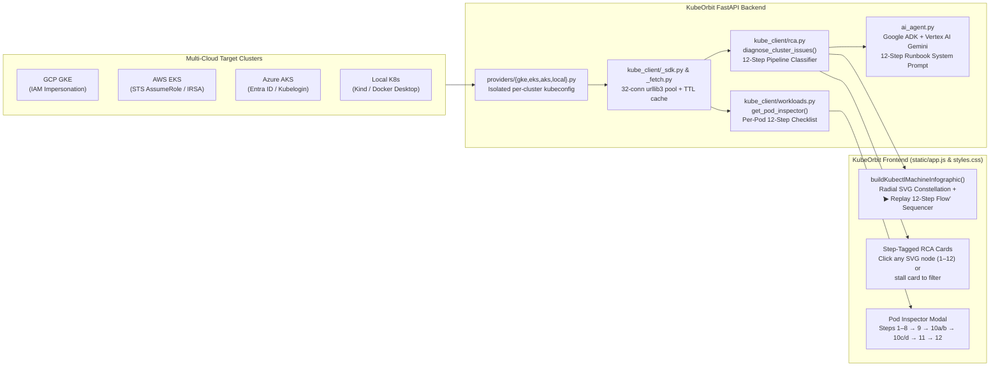

# The 12-Step `kubectl apply` Machine — Real-Time Multi-Cloud Infographic & Troubleshooting Engine

> [!IMPORTANT]
> **"Nothing talks to anything. Everything talks to the API server."**
> When an operator runs `kubectl apply`, **12 distinct control-plane and data-plane steps** execute before traffic reaches a Pod. Most production incidents (`Pending`, `ContainerCreating`, `ImagePullBackOff`, `0/1 Ready`, or `503 Service Unavailable`) occur at a specific handoff between Steps 8 and 12 — not because of invalid YAML syntax.
>
> KubeOrbit turns this 12-step mental model into a **live, real-time, provider-agnostic radial infographic and automated Root-Cause Analysis (RCA) engine** that works identically across **Google Cloud GKE**, **Amazon EKS**, **Azure AKS**, and **Local Kubernetes**.


---

## 1. Feature Architecture & End-to-End Data Flow

Zero data in the infographic is hardcoded. Every metric, step badge, glowing Bezier path, and stalled workload list is computed dynamically from the active cluster's Kubernetes API server on each load or refresh (`GET /api/clusters/{cluster_id}/diagnostics/rca` and `GET /api/clusters/{cluster_id}/namespaces/{namespace}/pods/{pod_name}/details`).



---

## 2. The 12 Pipeline Steps & How KubeOrbit Detects Each Stall

| Step | Stage & Component | What Happens in Kubernetes | How KubeOrbit Detects Stalls in Real Time ([`kube_client/rca.py`](../kube_client/rca.py)) |
| :--- | :--- | :--- | :--- |
| **1** | **`kubectl` Client**<br/>`{~/.kube/config}` $\rightarrow$ `{server-side-apply}` | Resolves cluster context and exec credential plugin (`gke-gcloud-auth-plugin`, `aws eks get-token`, `kubelogin`), sends manifest to `kube-apiserver`. | Verified via `providers/<provider>.py` and `kube_client/_cli.py` (with automatic retry on transient socket/NAT blips). |
| **2** | **`kube-apiserver`**<br/>`{authn}` | Authenticates caller identity (X.509 cert, OIDC token, ServiceAccount JWT, cloud IAM webhook). | Verified during cluster authentication (`ensure_cluster_authenticated`); surfaces `424 ProviderAuthError` if impersonation or token fails. |
| **3** | **`kube-apiserver`**<br/>`{rbac-authz}` | Checks `Role` / `ClusterRole` & `RoleBinding` / `ClusterRoleBinding` for `(user, verb, resource, namespace)`. | Enforced by in-cluster `ClusterRole/kubeorbit-cluster-access` and surfaced on any `403 Forbidden` API response. |
| **4** | **`kube-apiserver`**<br/>`{mutating-admission}` | Runs mutating webhooks (service mesh sidecar injection, `LimitRange` default CPU/memory requests, default `StorageClass`). | Inspected via pod spec injected containers/defaults and webhook admission events. |
| **5** | **`kube-apiserver`**<br/>`{schema-validation}` + `{validating-admission}` | Validates OpenAPI schema (RFC 1123 names, field types) and validating webhooks (OPA Gatekeeper, Kyverno, CEL policies). | Rejects invalid manifests before storage (`422 Invalid`). |
| **6** | **`etcd · cluster state`** | `kube-apiserver` writes the desired object state to `etcd` (**only `kube-apiserver` ever talks to `etcd`**). | Visualized as the 52-particle `etcd · cluster state` sphere showing the live total count of stored workloads (`summary.workloads_total`). |
| **7** | **`kube-controller-manager`**<br/>`{deployment-controller}` | Watches `Deployment` objects via informer, computes rollout revision, and creates/scales the active `ReplicaSet`. | Tracked via `Deployment` $\rightarrow$ `ReplicaSet` ownership and rollout revision history (`get_rollout_history`). |
| **8** | **`kube-controller-manager`**<br/>`{replicaset-controller}` + `{pod-security}` | `ReplicaSet` controller creates `Pod` objects. **PodSecurity Admission (`restricted`/`baseline`) and `ResourceQuota` are enforced here!** | **Step 8 Detector**: Scans `raw_replicasets` where `spec.replicas > 0` and `status.replicas < spec.replicas` with `FailedCreate` events or `ReplicaFailure` condition (`Step 8 · ReplicaSet / PodSecurity`). |
| **9** | **`kube-scheduler`**<br/>`{filter}` $\rightarrow$ `{score}` $\rightarrow$ `{bind}` | Filters nodes (CPU/memory requests, taints/tolerations, `nodeSelector`, `nodeAffinity`, topology spread, PVC binding), scores nodes, sets `spec.nodeName`. | **Step 9 Detector**: Scans `Pending` pods where `spec.nodeName` is unset or `PodScheduled=False` / `FailedScheduling` event exists, sub-classifying into:<br/>• `Step 9 · kube-scheduler (PVC)` (Unbound PVC)<br/>• `Step 9 · kube-scheduler (Capacity)` (Insufficient CPU/Memory)<br/>• `Step 9 · kube-scheduler (Taints)` (Untolerated Taint)<br/>• `Step 9 · kube-scheduler (Affinity)` (`nodeSelector` / `nodeAffinity` mismatch) |
| **10a** | **`kubelet · worker node`**<br/>`{csi-mount}` | Node `kubelet` attaches and mounts CSI PersistentVolumes, ConfigMaps, and Secrets into the pod directory. | **Step 10a Detector**: Detects pods assigned to a node (`spec.nodeName` set) stuck in `ContainerCreating` with `FailedMount` or `FailedAttachVolume` events (`Step 10a · kubelet CSI Mount`). |
| **10b** | **`kubelet · worker node`**<br/>`{cni-sandbox}` | `kubelet` invokes CNI plugin (GKE Dataplane V2 / Calico, AWS VPC CNI, Azure CNI, Cilium) to create network namespace and allocate Pod IP. | **Step 10b Detector**: Detects pods with `FailedCreatePodSandBox` or `NetworkNotReady` events (`Step 10b · kubelet CNI Sandbox`). |
| **10c** | **`kubelet · worker node`**<br/>`{image-pull}` | `kubelet` instructs container runtime (`containerd`) to pull container images using node credentials or `imagePullSecrets`. | **Step 10c Detector**: Detects `ImagePullBackOff` and `ErrImagePull` states (`Step 10c · kubelet Image Pull`). |
| **10d** | **`kubelet · worker node`**<br/>`{init-containers}` & `{containerd}` | Executes `initContainers` sequentially, resolves `env` / `envFrom` Secret & ConfigMap keys, and starts application containers in `containerd`. | **Step 10d Detector**: Classifies:<br/>• `CreateContainerConfigError` (`Step 10d · kubelet Container Config`)<br/>• `Init:Error` / `Init:CrashLoopBackOff` (`Step 10d · kubelet InitContainer`)<br/>• `OOMKilled` / exit code `137` (`Step 10d · kubelet OOMKilled`)<br/>• `CrashLoopBackOff` / non-zero exit (`Step 10d · kubelet Runtime (containerd)`) |
| **11** | **`kubelet · worker node`**<br/>`{startup-probe}` & `{readiness-probe}` | `kubelet` probes the running container via HTTP GET, TCP socket, or Exec. Until `readinessProbe` succeeds, Pod condition `Ready=False`. | **Step 11 Detector**: Detects pods where `status.phase == "Running"`, containers are running, but `Ready` condition is `False` (`0/N Ready`) or `Unhealthy` probe events exist (`Step 11 · kubelet Readiness Probe`). |
| **12** | **`kube-controller-manager` & Data Plane**<br/>`{endpointslice-controller}` $\rightarrow$ `EndpointSlice` $\rightarrow$ `kube-proxy` / eBPF | `endpointslice-controller` watches `Service.spec.selector` and `Ready` pods, populates `EndpointSlice` addresses, and `kube-proxy` / eBPF programs routing rules. | **Step 12 Detector**: Evaluates every `Service.spec.selector` against live namespace pods:<br/>• **0 matching pods** (label selector typo): `Step 12 · EndpointSlice (Selector Mismatch)`<br/>• **Matching pods exist, 0 Ready**: `Step 12 · EndpointSlice (0 Ready Endpoints)` |

---

## 3. Interactive Radial Infographic UI (`buildKubectlMachineInfographic`)

Implemented in [`static/app.js`](../static/app.js) and styled in [`static/styles.css`](../static/styles.css):

1. **Radial Constellation SVG Canvas (`1080 × 615` viewBox)**:
   - **`kube-apiserver` Central Hub**: Positioned at `(540, 310)` with an ambient radial glow, surrounded by all 12 numbered step badges (`1`–`12`) and ecosystem context nodes (`Argo CD`, `Helm`, `Prometheus`, `HPA`, `Karpenter / cluster-autoscaler`, `cert-manager`, `CoreDNS`, `EndpointSlice`, `Service`, `kube-proxy (or eBPF CNI)`).
   - **Dynamic Neon Bezier Paths**:
     - Healthy steps render with subtle cyan animated flow lines (`.is-healthy-edge`).
     - Stalled steps automatically switch to high-intensity pulsing crimson neon paths (`.is-stalled-edge`) with an expanding radar ring (`.km-pulse-circle`) around the numbered step badge.
   - **52-Particle `etcd · cluster state` Sphere**: Rendered using a golden-angle spiral at `(200, 145)` with the live workload count from the active cluster.
2. **"▶ Replay 12-Step Flow" Interactive Sequencer**:
   - Clicking **▶ Replay 12-Step Flow** steps sequentially from `Step 1` to `Step 12` (1.25s per step), illuminating that step's Bezier curve in golden-amber (`.is-active-step`) and updating the live narrator bar with whether the active cluster is passing (`✓ PASSING IN CLUSTER`) or stalling (`⚠ N STALLED IN CLUSTER`) at that stage.
3. **Click-to-Filter on SVG Nodes & "Where It Stalls" Telemetry Cards**:
   - Clicking any numbered badge (`1`–`12`) on the SVG canvas or any of the 6 bottom-right **"Where it stalls"** cards (`Pending`, `ContainerCreating`, `ImagePullBackOff`, `CrashLoop / OOMKilled`, `0/1 Ready`, `503 from Ingress / Service`) filters the RCA runbook cards below to that pipeline stage.
4. **Per-Pod 12-Step Lifecycle Checklist in Pod Inspector**:
   - Clicking **Inspect** on any Pod opens the Pod Inspector modal (`renderPodInspectorModal`), which renders a 6-card **12-Step Delivery Pipeline Status (`kubectl apply` $\rightarrow$ Traffic)** checklist (`Steps 1–8`, `Step 9`, `Step 10a/b`, `Step 10c/d`, `Step 11`, `Step 12`) with exact pass/fail status and cluster evidence for that individual pod.
5. **12-Step AI Agent Integration ([`ai_agent.py`](../ai_agent.py))**:
   - Both **"✨ Diagnose with AI"** and **"Ask AI"** use the 12-Step `kubectl apply` Machine system instruction so Gemini responses always identify the exact stalled step number, cite live cluster evidence, and provide copy-pasteable `kubectl` remediation commands.

---

## 4. Multi-Cloud Compatibility (GKE, EKS, AKS, Local)

Because provider-specific authentication is decoupled in [`providers/gke.py`](../providers/gke.py), [`providers/eks.py`](../providers/eks.py), [`providers/aks.py`](../providers/aks.py), and [`providers/local.py`](../providers/local.py), the 12-Step engine operates purely on standard Kubernetes API resources and event reasons:

| Pipeline Stage | GKE (Google Cloud) | EKS (Amazon Web Services) | AKS (Microsoft Azure) |
| :--- | :--- | :--- | :--- |
| **Steps 1–3 (Auth & RBAC)** | `gke-gcloud-auth-plugin` + IAM Service Account Impersonation | `aws eks get-token` + STS `AssumeRole` / Access Entries | `kubelogin` + Entra ID Workload Identity / Federated Credentials |
| **Step 9 (Scheduler)** | GKE Autopilot / Standard `kube-scheduler` & Cluster Autoscaler | `kube-scheduler` & Karpenter / Cluster Autoscaler | `kube-scheduler` & AKS Cluster Autoscaler |
| **Step 10a (CSI Mount)** | GCE PD CSI (`standard-rwo` / `premium-rwo`), Secret/ConfigMap volumes | AWS EBS / EFS CSI Driver, Secret/ConfigMap volumes | Azure Disk / Azure Files CSI Driver, Secret/ConfigMap volumes |
| **Step 10b (CNI Sandbox)** | GKE Dataplane V2 (Cilium eBPF) / Calico CNI | Amazon VPC CNI (`aws-node`) | Azure CNI Overlay / Cilium |
| **Step 10c (Image Pull)** | Artifact Registry (`*.pkg.dev`) / Docker Hub | Amazon ECR (`*.dkr.ecr.*.amazonaws.com`) | Azure Container Registry (`*.azurecr.io`) |
| **Step 12 (EndpointSlice & LB)** | GKE GCE Ingress / Gateway controller & `EndpointSlice` | AWS Load Balancer Controller (ALB/NLB) & `EndpointSlice` | Azure App Gateway / NGINX Ingress & `EndpointSlice` |

---

## 5. Testing All 12-Step Scenarios with [`sample-app.yaml`](../sample-app.yaml)

Applying [`sample-app.yaml`](../sample-app.yaml) deploys both a healthy multi-tier application (`web-frontend`, `api-backend`, `cache-redis`, `payment-db`, `node-monitor`, `db-schema-migration-v2`, `analytics-sync`) and intentional, low-footprint test workloads for each stall point in namespace `kubeorbit-demo`:

```bash
kubectl apply -f sample-app.yaml
```

- **Step 9 (`Pending` Scheduler Stall)**: `Deployment/gpu-ml-inference` (`nodeSelector: accelerator: nvidia-h100-gpu`)
- **Step 10a (`ContainerCreating` CSI Mount Stall)**: `Deployment/audit-shipper-csi` (mounts missing Secret `missing-mtls-client-cert`)
- **Step 10c (`ImagePullBackOff` Stall)**: `Deployment/checkout-canary` (pulls nonexistent tag `nginx:nonexistent-canary-v99.9.9`)
- **Step 10d (`CrashLoopBackOff` / `OOMKilled` Stall)**: `Deployment/faulty-worker` (exits non-zero with simulated OOM allocation failure)
- **Step 11 (`0/1 Ready` Readiness Probe Stall)**: `Deployment/inventory-unready` (container listens on `:8080`, `readinessProbe` checks `:9099/healthz`)
- **Step 12 (`503` Service Selector Mismatch / 0 Endpoints)**: `Service/orphaned-orders-svc` (`selector: app: orders-service-typo-v99` matches 0 pods)
