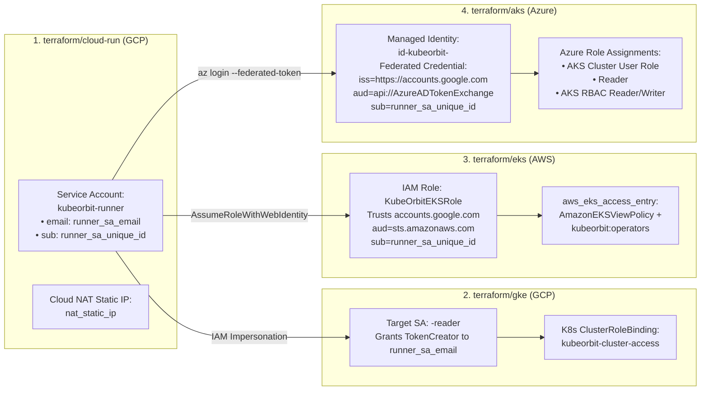

# KubeOrbit Enterprise Multi-Cloud Terraform Infrastructure

This directory contains production-ready, modular **Terraform** stacks to deploy **KubeOrbit** on **Google Cloud Run behind Identity-Aware Proxy (IAP)** and provision/authorize **GCP GKE**, **AWS EKS**, and **Azure AKS** clusters using **Zero-Key OIDC Workload Identity Federation** (zero static service account JSON keys, AWS access keys, or Azure client secrets).

---

## 1. Directory Structure & Modules

| Module Path | Cloud / Target | Purpose & Key Resources | Detailed Guide |
| :--- | :--- | :--- | :--- |
| [**`terraform/cloud-run/`**](./cloud-run/) | **GCP Cloud Run + IAP** | Artifact Registry, VPC + Cloud NAT (Static IP), Secret Manager (`clusters.yaml`), `kubeorbit-runner` Service Account, Cloud Run v2 Service with IAP & 3-Tier RBAC | [**`cloud-run/README.md`**](./cloud-run/README.md) |
| [**`terraform/gke/`**](./gke/) | **Google GKE** | VPC/Subnet, GKE Standard Cluster + Node Pool, `kubeorbit-gke-reader` SA, IAM Impersonation (`roles/iam.serviceAccountTokenCreator`), Kubernetes `ClusterRole` & `ClusterRoleBinding` | [**`gke/README.md`**](./gke/README.md) |
| [**`terraform/eks/`**](./eks/) | **AWS EKS** | VPC/Subnets/IGW, EKS Cluster (`API_AND_CONFIG_MAP`) + Managed Node Group, `KubeOrbitEKSRole` trusting `accounts.google.com` (`sts:AssumeRoleWithWebIdentity`), `aws_eks_access_entry` + K8s RBAC | [**`eks/README.md`**](./eks/README.md) |
| [**`terraform/aks/`**](./aks/) | **Azure AKS** | Resource Group, AKS Cluster (Entra ID + Azure RBAC enabled), User-Assigned Managed Identity + `azurerm_federated_identity_credential` (`api://AzureADTokenExchange`), Azure & K8s Role Assignments | [**`aks/README.md`**](./aks/README.md) |

---

## 2. End-to-End Multi-Cloud Authentication & Authorization Matrix



---

## 3. Recommended Execution Order

### Phase 1: Deploy KubeOrbit Portal on Cloud Run (`terraform/cloud-run`)
1. Copy `terraform/cloud-run/terraform.tfvars.example` to `terraform/cloud-run/terraform.tfvars` and set `project_id`, `admin_emails`, and `iap_authorized_members`.
2. Run `terraform init && terraform apply` inside `terraform/cloud-run`.
3. Capture the identity & network outputs:
   ```bash
   cd terraform/cloud-run
   terraform output runner_sa_email      # Needed by terraform/gke
   terraform output runner_sa_unique_id  # Needed by terraform/eks and terraform/aks
   terraform output nat_static_ip        # Optional firewall allowlist IP for GKE/EKS/AKS
   ```

### Phase 2: Provision & Authorize Target Clusters (`gke`, `eks`, `aks`)
Run any or all of the target cluster modules in parallel:
- **GKE (`terraform/gke`)**: Pass `cloudrun_sa_email` -> outputs `kubeorbit_ui_registration_summary`.
- **EKS (`terraform/eks`)**: Pass `cloudrun_sa_unique_id` -> outputs `kubeorbit_ui_registration_summary`.
- **AKS (`terraform/aks`)**: Pass `cloudrun_sa_unique_id` -> outputs `kubeorbit_ui_registration_summary`.

### Phase 3: Register Clusters in the KubeOrbit UI
Open your Cloud Run IAP URL, click **`+ Register Cluster`**, select **GKE**, **EKS**, or **AKS**, and paste the values from `terraform output kubeorbit_ui_registration_summary`.
