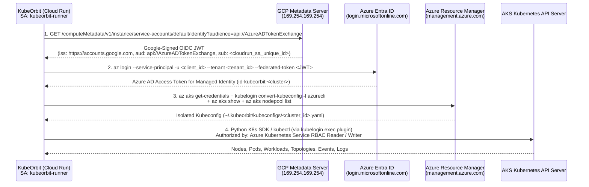

# Azure Kubernetes Service (AKS) — Provisioning, Entra ID Federated Credential & Azure RBAC Guide

This module (`terraform/aks/`) provisions an Azure Kubernetes Service (AKS) cluster (with **Azure Entra ID + Azure RBAC for Kubernetes** enabled) and configures **Zero-Key Cross-Cloud Workload Identity Federation** (`https://accounts.google.com` -> Azure Entra ID `api://AzureADTokenExchange`) so **KubeOrbit** running on Google Cloud Run can authenticate and inspect AKS without any client secrets or certificates.

---

## 1. How GCP Cloud Run Authenticates to Azure AKS (Zero-Key Federated Flow)



### Resources Provisioned by [`auth_federated_rbac.tf`](./auth_federated_rbac.tf)
1. **User-Assigned Managed Identity (`azurerm_user_assigned_identity.kubeorbit`)**:
   - Dedicated Azure identity (`id-kubeorbit-<cluster_name>`) with zero passwords or client secrets.
2. **Federated Identity Credential (`azurerm_federated_identity_credential.gcp_cloudrun`)**:
   - Trusts `issuer = "https://accounts.google.com"`, `subject = var.cloudrun_sa_unique_id`, and `audience = ["api://AzureADTokenExchange"]`.
3. **Azure & Kubernetes Role Assignments (`azurerm_role_assignment`)**:
   - `Azure Kubernetes Service Cluster User Role`: Allows `az aks get-credentials`.
   - `Reader`: Allows `az aks show` and `az aks nodepool list` for KubeOrbit's Control Plane & Cost views.
   - `Azure Kubernetes Service RBAC Reader`: Grants cluster-wide read access to Kubernetes resources inside AKS.
   - `Azure Kubernetes Service RBAC Writer` (when `enable_operator_permissions = true`): Enables KubeOrbit's audited **Operator Secret Reveal** and **Workload Rollback** actions.

---

## 2. Step-by-Step Terraform Execution

### Step 1: Get `runner_sa_unique_id` from `terraform/cloud-run`
```bash
# Either from terraform output in terraform/cloud-run:
cd ../cloud-run && terraform output runner_sa_unique_id

# Or directly via gcloud CLI:
gcloud iam service-accounts describe \
  "kubeorbit-runner@adk-enterprise-observability.iam.gserviceaccount.com" \
  --format="value(uniqueId)"
```

### Step 2: Configure `terraform.tfvars`
```bash
cd ../aks
cp terraform.tfvars.example terraform.tfvars
```

Edit `terraform.tfvars`:
```hcl
subscription_id       = "00000000-0000-0000-0000-000000000000"
location              = "eastus"
resource_group_name   = "rg-kubeorbit-aks"
cluster_name          = "kubeorbit-aks"
environment           = "sandbox"
cloudrun_sa_unique_id = "112233445566778899000" # Paste numeric uniqueId here
```

### Step 3: Initialize & Apply
```bash
az login
terraform init
terraform plan
terraform apply
```

### Step 4: View Onboarding Outputs for KubeOrbit UI
```bash
terraform output kubeorbit_ui_registration_summary
```

Example output:
```hcl
{
  "client_id"       = "22222222-2222-2222-2222-222222222222"
  "cluster_name"    = "kubeorbit-aks"
  "environment"     = "sandbox"
  "provider"        = "aks"
  "resource_group"  = "rg-kubeorbit-aks"
  "subscription_id" = "00000000-0000-0000-0000-000000000000"
  "tenant_id"       = "11111111-1111-1111-1111-111111111111"
}
```

---

## 3. Authorizing an Existing AKS Cluster (Azure CLI Commands)

If you already have an existing AKS cluster, you can apply only [`auth_federated_rbac.tf`](./auth_federated_rbac.tf) or run these Azure CLI commands:

```bash
export AZ_SUBSCRIPTION_ID="<YOUR_AZURE_SUBSCRIPTION_ID>"
export AZ_RG="rg-existing-aks"
export AKS_CLUSTER="existing-aks-cluster"
export GCP_SA_SUB="<NUMERIC_UNIQUE_ID_OF_CLOUDRUN_SA>"

# 1. Create User-Assigned Managed Identity
az identity create \
  --name "id-kubeorbit-${AKS_CLUSTER}" \
  --resource-group "${AZ_RG}" \
  --subscription "${AZ_SUBSCRIPTION_ID}"

export CLIENT_ID=$(az identity show -n "id-kubeorbit-${AKS_CLUSTER}" -g "${AZ_RG}" --query clientId -o tsv)
export PRINCIPAL_ID=$(az identity show -n "id-kubeorbit-${AKS_CLUSTER}" -g "${AZ_RG}" --query principalId -o tsv)
export TENANT_ID=$(az account show --query tenantId -o tsv)

# 2. Create Federated Credential trusting Google Cloud Run SA OIDC
az identity federated-credential create \
  --name gcp-cloudrun-kubeorbit-federation \
  --identity-name "id-kubeorbit-${AKS_CLUSTER}" \
  --resource-group "${AZ_RG}" \
  --issuer "https://accounts.google.com" \
  --subject "${GCP_SA_SUB}" \
  --audiences "api://AzureADTokenExchange"

# 3. Assign Azure & Kubernetes RBAC Roles on the AKS Cluster
export AKS_ID=$(az aks show -n "${AKS_CLUSTER}" -g "${AZ_RG}" --query id -o tsv)

for ROLE in \
  "Azure Kubernetes Service Cluster User Role" \
  "Reader" \
  "Azure Kubernetes Service RBAC Reader"; do
  az role assignment create \
    --assignee-object-id "${PRINCIPAL_ID}" \
    --assignee-principal-type ServicePrincipal \
    --role "${ROLE}" \
    --scope "${AKS_ID}"
done
```

---

## 4. What to Enter in the KubeOrbit UI

Open **KubeOrbit** -> Click **`+ Register Cluster`** -> Select **AKS**:
- **Cluster Display Name**: `Azure AKS Sandbox` (or any display name)
- **Environment**: `Sandbox` / `Non-Prod` / `Production`
- **Resource Group**: `<aks_resource_group>` (e.g., `rg-kubeorbit-aks`)
- **Cluster Name**: `<aks_cluster_name>` (e.g., `kubeorbit-aks`)
- **Subscription ID**: `<aks_subscription_id>`
- **Entra Tenant ID**: `<aks_tenant_id>`
- **Federated Managed Identity / App Client ID**: `<aks_federated_client_id>`
