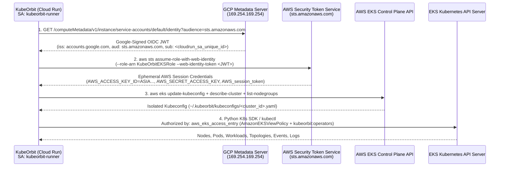

# Amazon EKS (AWS) — Provisioning, Zero-Key GCP OIDC Federation & EKS Access Entries Guide

This module (`terraform/eks/`) provisions an Amazon EKS cluster and configures **Zero-Key Cross-Cloud OIDC Web Identity Federation** (`accounts.google.com` -> AWS `sts:AssumeRoleWithWebIdentity`) + **EKS Access Entries** so **KubeOrbit** running on Google Cloud Run can authenticate and inspect EKS without any long-lived `AWS_ACCESS_KEY_ID` or `AWS_SECRET_ACCESS_KEY`.

---

## 1. How GCP Cloud Run Authenticates to AWS EKS (Zero-Key OIDC Flow)



### Why No Custom AWS IAM OIDC Provider Resource Is Needed for Google
AWS IAM natively trusts `accounts.google.com` as a built-in OpenID Connect Identity Provider. In [`auth_oidc_rbac.tf`](./auth_oidc_rbac.tf), `aws_iam_role.kubeorbit_eks_role` uses:
```json
{
  "Version": "2012-10-17",
  "Statement": [
    {
      "Sid": "AllowGCPCloudRunServiceAccountOIDC",
      "Effect": "Allow",
      "Principal": {
        "Federated": "accounts.google.com"
      },
      "Action": "sts:AssumeRoleWithWebIdentity",
      "Condition": {
        "StringEquals": {
          "accounts.google.com:aud": "sts.amazonaws.com",
          "accounts.google.com:sub": "<cloudrun_sa_unique_id>"
        }
      }
    }
  ]
}
```
This guarantees that **only** your specific `kubeorbit-runner` Cloud Run Service Account (identified by its immutable numeric `unique_id` / `sub`) can assume the AWS IAM role.

---

## 2. Step-by-Step Terraform Execution

### Step 1: Get `runner_sa_unique_id` from `terraform/cloud-run`
```bash
# Either from terraform output in terraform/cloud-run:
cd ../cloud-run && terraform output runner_sa_unique_id

# Or directly via gcloud CLI:
gcloud iam service-accounts describe \
  "kubeorbit-runner@adk-enterprise-observability.iam.gserviceaccount.com" \
  --format="value(uniqueId)"
```

### Step 2: Configure `terraform.tfvars`
```bash
cd ../eks
cp terraform.tfvars.example terraform.tfvars
```

Edit `terraform.tfvars`:
```hcl
aws_region            = "us-east-1"
cluster_name          = "kubeorbit-eks"
kubernetes_version    = "1.30"
environment           = "sandbox"
cloudrun_sa_unique_id = "112233445566778899000" # Paste numeric uniqueId here
```

### Step 3: Initialize & Apply
```bash
terraform init
terraform plan
terraform apply
```

### Step 4: View Onboarding Outputs for KubeOrbit UI
```bash
terraform output kubeorbit_ui_registration_summary
```

Example output:
```hcl
{
  "cluster_name" = "kubeorbit-eks"
  "environment"  = "sandbox"
  "provider"     = "eks"
  "region"       = "us-east-1"
  "role_arn"     = "arn:aws:iam::123456789012:role/KubeOrbitEKSRole-kubeorbit-eks"
}
```

---

## 3. Authorizing an Existing EKS Cluster (CLI Commands)

If you already have an existing EKS cluster, you can either apply only [`auth_oidc_rbac.tf`](./auth_oidc_rbac.tf) or run these AWS CLI commands:

```bash
export EKS_CLUSTER="existing-eks-cluster"
export AWS_REGION="us-east-1"
export GCP_SA_SUB="<NUMERIC_UNIQUE_ID_OF_CLOUDRUN_SA>"

# 1. Create the IAM Role trusting Google OIDC
cat > trust-policy.json <<EOF
{
  "Version": "2012-10-17",
  "Statement": [
    {
      "Effect": "Allow",
      "Principal": { "Federated": "accounts.google.com" },
      "Action": "sts:AssumeRoleWithWebIdentity",
      "Condition": {
        "StringEquals": {
          "accounts.google.com:aud": "sts.amazonaws.com",
          "accounts.google.com:sub": "${GCP_SA_SUB}"
        }
      }
    }
  ]
}
EOF

ROLE_ARN=$(aws iam create-role \
  --role-name "KubeOrbitEKSRole-${EKS_CLUSTER}" \
  --assume-role-policy-document file://trust-policy.json \
  --query "Role.Arn" --output text)

# 2. Attach EKS Describe permissions
aws iam put-role-policy \
  --role-name "KubeOrbitEKSRole-${EKS_CLUSTER}" \
  --policy-name KubeOrbitEKSControlPlaneRead \
  --policy-document '{
    "Version": "2012-10-17",
    "Statement": [{
      "Effect": "Allow",
      "Action": ["eks:DescribeCluster", "eks:ListNodegroups", "eks:DescribeNodegroup", "eks:ListClusters"],
      "Resource": "*"
    }]
  }'

# 3. Create EKS Access Entry & Associate AmazonEKSViewPolicy
aws eks create-access-entry \
  --region "${AWS_REGION}" \
  --cluster-name "${EKS_CLUSTER}" \
  --principal-arn "${ROLE_ARN}" \
  --type STANDARD

aws eks associate-access-policy \
  --region "${AWS_REGION}" \
  --cluster-name "${EKS_CLUSTER}" \
  --principal-arn "${ROLE_ARN}" \
  --policy-arn arn:aws:eks::aws:cluster-access-policy/AmazonEKSViewPolicy \
  --access-scope type=cluster
```

---

## 4. What to Enter in the KubeOrbit UI

Open **KubeOrbit** -> Click **`+ Register Cluster`** -> Select **EKS**:
- **Cluster Display Name**: `AWS EKS Sandbox` (or any display name)
- **Environment**: `Sandbox` / `Non-Prod` / `Production`
- **AWS Region**: `<eks_region>` (e.g., `us-east-1`)
- **Cluster Name**: `<eks_cluster_name>` (e.g., `kubeorbit-eks`)
- **IAM Role ARN**: `<eks_role_arn>` (e.g., `arn:aws:iam::123456789012:role/KubeOrbitEKSRole-kubeorbit-eks`)
