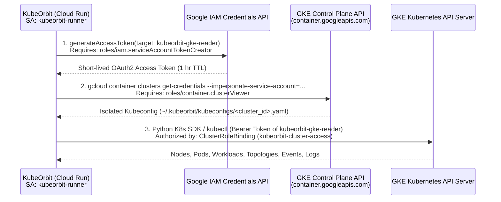

# Google Kubernetes Engine (GKE) — Provisioning, IAM Impersonation & K8s RBAC Guide

This module (`terraform/gke/`) provisions a GKE cluster and configures **Zero-Key IAM Service Account Impersonation** + **Kubernetes RBAC** so **KubeOrbit** running on Cloud Run can authenticate and inspect the cluster without any static JSON service account keys.

---

## 1. How GKE Authentication & Authorization Work in KubeOrbit



### Three Security Layers Provisioned by [`auth_iam_rbac.tf`](./auth_iam_rbac.tf)
1. **Target GKE Reader Service Account (`google_service_account.gke_reader`)**:
   - Created in the target GKE project (`<cluster_name>-reader@<project_id>.iam.gserviceaccount.com`).
   - Isolates permissions per cluster/project so the Cloud Run runtime SA itself holds zero direct cluster privileges.
2. **GCP IAM Impersonation & Control-Plane Metadata**:
   - `roles/iam.serviceAccountTokenCreator` is granted to Cloud Run's `kubeorbit-runner` SA (`var.cloudrun_sa_email`) **only** on `google_service_account.gke_reader`.
   - `roles/container.clusterViewer` is granted to `google_service_account.gke_reader` on the GKE project so KubeOrbit can fetch cluster control-plane metadata (Kubernetes version, node pools, Workload Identity pool, VPC/subnet, CIDR ranges) and generate the kubeconfig.
3. **In-Cluster Kubernetes RBAC (`kubernetes_cluster_role.kubeorbit_access` & `kubernetes_cluster_role_binding.kubeorbit_binding`)**:
   - Binds `User: <cluster_name>-reader@<project_id>.iam.gserviceaccount.com` to `ClusterRole: kubeorbit-cluster-access`.
   - Grants `get`, `list`, `watch` on core, workload, networking, Gateway API, storage, metrics, and CRD resources.
   - When `enable_operator_permissions = true` (default), also grants `get`/`list` on `secrets` (for audited **Operator Secret Reveal**) and `patch`/`update` on `deployments`, `statefulsets`, `daemonsets`, and `replicasets` (for audited **Operator Workload Rollback**).

---

## 2. Step-by-Step Terraform Execution

### Step 1: Configure `terraform.tfvars`
```bash
cd terraform/gke
cp terraform.tfvars.example terraform.tfvars
```

Edit `terraform.tfvars` with your GCP project ID and the `runner_sa_email` output from `terraform/cloud-run`:
```hcl
project_id             = "adk-enterprise-observability"
region                 = "us-central1"
location               = "us-central1-a"
cluster_name           = "kubeorbit-gke"
environment            = "sandbox"
cloudrun_sa_email      = "kubeorbit-runner@adk-enterprise-observability.iam.gserviceaccount.com"
cloudrun_nat_static_ip = "" # Optional: paste nat_static_ip from terraform/cloud-run if restricting Master Authorized Networks
```

### Step 2: Initialize & Apply
```bash
terraform init
terraform plan
terraform apply
```

### Step 3: View Onboarding Outputs for KubeOrbit UI
```bash
terraform output kubeorbit_ui_registration_summary
```

Example output:
```hcl
{
  "cluster_name" = "kubeorbit-gke"
  "environment" = "sandbox"
  "impersonate_service_account" = "kubeorbit-gke-reader@adk-enterprise-observability.iam.gserviceaccount.com"
  "project" = "adk-enterprise-observability"
  "provider" = "gke"
  "zone_or_region" = "us-central1-a"
}
```

---

## 3. Registering an Existing GKE Cluster (Only Auth & RBAC)

If you already have an existing GKE cluster and only want to apply the IAM Impersonation + Kubernetes RBAC resources without creating a new GKE cluster, run the following commands or use `auth_iam_rbac.tf`:

```bash
export PROJECT_ID="adk-enterprise-observability"
export CLUSTER_NAME="existing-gke-cluster"
export CLOUDRUN_SA="kubeorbit-runner@adk-enterprise-observability.iam.gserviceaccount.com"

# 1. Create target GKE Reader SA
gcloud iam service-accounts create "${CLUSTER_NAME}-reader" \
  --display-name="KubeOrbit Reader SA (${CLUSTER_NAME})" \
  --project="${PROJECT_ID}"

export READER_SA="${CLUSTER_NAME}-reader@${PROJECT_ID}.iam.gserviceaccount.com"

# 2. Grant GKE Control Plane Viewer role
gcloud projects add-iam-policy-binding "${PROJECT_ID}" \
  --member="serviceAccount:${READER_SA}" \
  --role="roles/container.clusterViewer"

# 3. Allow Cloud Run SA to impersonate the Reader SA
gcloud iam service-accounts add-iam-policy-binding "${READER_SA}" \
  --project="${PROJECT_ID}" \
  --member="serviceAccount:${CLOUDRUN_SA}" \
  --role="roles/iam.serviceAccountTokenCreator"

# 4. Bind Kubernetes RBAC inside the cluster
kubectl create clusterrolebinding kubeorbit-reader-binding \
  --clusterrole=view \
  --user="${READER_SA}"
```

---

## 4. What to Enter in the KubeOrbit UI

Open **KubeOrbit** -> Click **`+ Register Cluster`** -> Select **GKE**:
- **Cluster Display Name**: `OBS SBX` (or any human-friendly name)
- **Environment**: `Sandbox` / `Non-Prod` / `Production`
- **Project ID**: `<gke_project_id>` (e.g., `adk-enterprise-observability`)
- **Region / Zone**: `<gke_location>` (e.g., `us-central1-a`)
- **GKE Cluster Name**: `<gke_cluster_name>` (e.g., `kubeorbit-gke`)
- **Impersonate Service Account**: `<gke_impersonate_service_account>` (e.g., `kubeorbit-gke-reader@adk-enterprise-observability.iam.gserviceaccount.com`)
